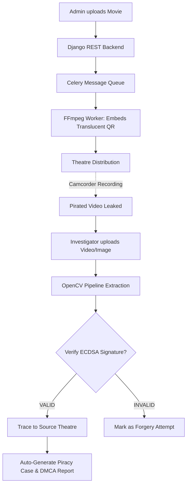

# 🎬 CineMark Anti-Piracy Ecosystem

A cinematic security and forensic platform that fights theatre-based camcorder piracy. Every theatre's copy of a movie carries an invisible, cryptographically signed watermark. If a pirated copy leaks, investigators upload a video or screenshot and CineMark traces it back to the exact **theatre and showtime**, then generates a DMCA takedown notice automatically.

---

## ✨ Key Features

- **Per-theatre watermarking**: a low-opacity, dynamically placed QR code is embedded into the video with FFmpeg. It holds the theatre ID, the showtime and an ECDSA P-256 signature.
- **Forensic detection engine**: scan a full video or a single frame snapshot, such as a phone photo of a pirated screen.
- **Robust recovery**: OpenCV uses Adaptive Thresholding and CLAHE to recover watermarks despite blur, rotation, letter-boxing, brightness shifts and heavy H.264 compression.
- **Forgery protection**: ECDSA signatures stop attackers from fabricating evidence against innocent theatres.
- **Automated compliance**: each detected leak opens a Piracy Case and lowers the theatre's compliance score. Theatres that fall below the threshold (e.g. <30%) are blacklisted from future distribution.
- **Analytics dashboard**: shows threat severity, resolution rates and the most pirated movies.
- **1-click DMCA reports**: generates a PDF takedown notice in seconds.
- **Audit logging and RBAC**: logins, uploads and downloads are recorded. Access is role-based (`ADMIN`, `DISTRIBUTOR`, `INVESTIGATOR`).

---

## 🧠 How It Works



The system works in three phases:

1. **Protection (asset management and distribution)**: movies are uploaded to the library and theatres are registered. Admins define showtimes, which trigger a Celery worker. The worker uses FFmpeg to overlay a shifting translucent QR code that is unique to that venue.
2. **Detection (forensic engine)**: investigators upload a video or frame. OpenCV recovers the QR payload and the backend verifies the ECDSA signature.
3. **Enforcement (analytics and compliance)**: a verified leak opens a case, lowers the theatre's score, can trigger blacklisting, and can produce a DMCA PDF.

### Why not other approaches?

| Technique | Limitation |
|---|---|
| Visible watermarks | Ruin the viewing experience and are easily cropped or blurred |
| Audio watermarking | Fails on muted or dubbed recordings and is hurt by ambient noise |
| Hardware forensic watermarking (e.g. NexGuard) | Needs expensive proprietary projectors in every theatre |
| **CineMark (software QR + cryptography)** | Hardware-grade robustness at a fraction of the cost |

---

## 🧰 Tech Stack

| Layer | Technologies |
|---|---|
| Backend | Python 3.9+, Django, Django REST Framework, Celery, Redis (or filesystem broker) |
| Video / CV | FFmpeg, OpenCV (`cv2`) |
| Security | `cryptography` (ECDSA P-256) |
| Reports | ReportLab (PDF) |
| Frontend | React.js, Vite, React Router, Axios, Lucide React |
| Database | SQLite (development), PostgreSQL (production) |

---

## 📋 Requirements

**Server**
- Multi-core CPU (Core i7 / Ryzen 7 or equivalent cloud compute)
- 8–16 GB RAM
- SSD storage, sized to your movie library
- FFmpeg installed and available on `PATH`

**Client / Investigator**
- Any modern browser on a laptop, desktop, tablet or smartphone
- Optional: a camera for capturing snapshots of pirated screens

**Software**: Python 3.9+, Node.js, Redis (optional), FFmpeg

---

## 🚀 Getting Started

> Folder names and commands below are typical for a Django and React project. Adjust them to match the repository layout.

### 1. Clone the repository

```bash
git clone https://github.com/Kishan0507/moviepiracy.git
cd moviepiracy
```

### 2. Backend setup

```bash
cd backend
python -m venv venv
source venv/bin/activate        # Windows: venv\Scripts\activate
pip install -r requirements.txt

python manage.py migrate
python manage.py createsuperuser
python manage.py runserver
```

### 3. Start the background worker

```bash
# With Redis as broker
celery -A <project_name> worker --loglevel=info
```

If Celery isn't running, watermarking falls back to background threads via `dispatch_watermark()`.

### 4. Frontend setup

```bash
cd frontend
npm install
npm run dev
```

Open the Vite URL shown in the terminal (usually `http://localhost:5173`).

---

## 🔌 API Overview

| Method | Endpoint | Description |
|---|---|---|
| `POST` | `/api/movies/detect/` | Scan an uploaded video for a watermark |
| `POST` | `/api/movies/detect_frame/` | Detect a watermark in an image or snapshot |
| `GET` | `/api/cases/{id}/dmca/` | Generate a DMCA takedown PDF for a case |

Other REST resources cover `Theatre`, `Movie`, `MovieTiming`, `PiracyCase` and `WatermarkTask`.

---

## 🗄️ Data Model

- **Theatre**: venue details, location and a dynamic `compliance_score`
- **Movie / MovieTiming**: asset metadata and scheduled showings per theatre
- **WatermarkTask**: progress of async watermark generation
- **PiracyCase**: investigations with state (`OPEN`, `RESOLVED`) and severity
- **AuditLog**: user action trail to deter insider tampering

---

## 🔐 Security

- **RBAC**: tools are limited to `ADMIN`, `DISTRIBUTOR` and `INVESTIGATOR` roles.
- **ECDSA P-256 signatures**: without the private key, an attacker cannot forge a valid payload to frame a theatre. **Keep the private key out of version control.**
- **Audit trail**: key actions are logged silently.
- **Tested against degradation**: H.264 artifacts, lens blur, perspective warp and low light or contrast.

---

## 📊 Results

Based on system trials:

- FFmpeg embeds watermarks without significant fidelity loss.
- The OpenCV pipeline has a **>90% recovery rate** under letter-boxing, brightness changes and camcorder shake.
- **0%** of forged payloads passed signature verification.
- DMCA generation drops from hours to seconds.

---

## 🛣️ Roadmap

- **Cloud and distributed processing**: AWS MediaConvert and S3 storage for large video files.
- **OSINT web crawling**: bots that scan torrent indexes and social platforms (Telegram, Twitter) for leaks.
- **ML integration**: CNNs to recover heavily degraded watermarks that thresholding misses.
- **Real-time threat feeds**: integration with industry anti-piracy databases.

---

## 📁 Project Structure

```
moviepiracy/
├── backend/        # Django + DRF API, Celery tasks, OpenCV detectors, crypto, PDF generation
└── frontend/       # React + Vite UI (Dashboard, Asset & Showtime managers, Pirate Detector, Analytics)
```

--
